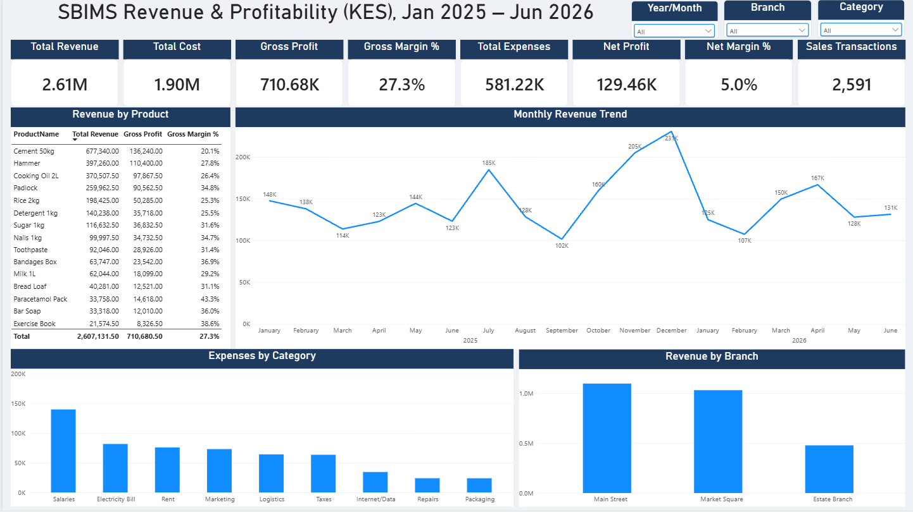

# Small Business Inventory & Management System (SBIMS) — Microsoft Fabric Pipeline

End-to-end Microsoft Fabric project: a medallion lakehouse (Bronze → Silver → Gold) feeding a Power BI revenue & profitability report for a 3-branch retail/hardware business.  
All amounts in **Kenyan Shillings (KES)**. **Synthetic data** — no real business or customer data.

## Architecture
| Layer | Notebook | What it does |
|---|---|---|
| Bronze | `01_Bronze_GenerateRawData` | Generates raw synthetic transactions (Jan 2025 – Jun 2026) |
| Silver | `02_Silver_CleanAndValidate` | Cleans and validates the raw data |
| Gold | `03_Gold_BuildStarSchema` | Builds a star schema for reporting |

**Gold star schema:** dimensions for branches, date, employees, expense categories, payment methods, products and suppliers; fact tables for sales, expenses, stock purchases, stock adjustments and stock ledger.

**Semantic model:** `SBIMS_Gold_Model` → **Report:** `SBIMS Revenue & Profitability Report`

## Key results (Jan 2025 – Jun 2026)
- Revenue **KES 2.61M**, Gross Profit **KES 710.68K** (27.3% margin), Net Profit **KES 129.46K** (5.0% margin) across 2,591 sales transactions.
- Operating expenses consume about **82% of gross profit**; salaries are the largest expense category.
- **Cement 50kg** brings in ~26% of revenue but has the **lowest margin (20.1%)**; Paracetamol Pack has the highest (43.3%).
- Revenue peaked in **December 2025 (~231K)** and was lowest in **September 2025 (~102K)**.
- Estate Branch generates roughly half the revenue of Main Street or Market Square.

## Tools
Microsoft Fabric (Lakehouse, PySpark notebooks, OneLake), Power BI (semantic model, report), Git integration with GitHub.

## Repository contents
- `fabric/` — Fabric items synced via Git integration (notebooks, lakehouse definition, semantic model, report)
- `dashboard.png` — report screenshot
